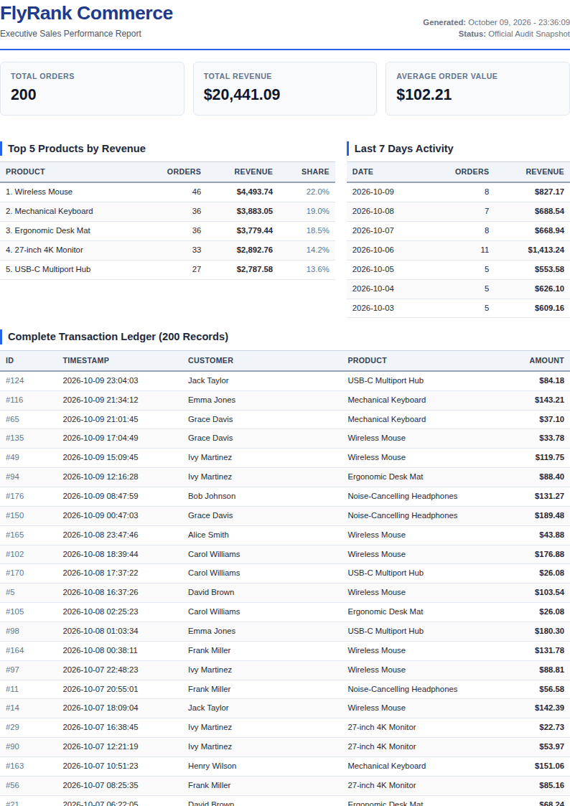

# FlyRank PDF Report Generator 

A robust data-to-document backend pipeline built with **Python 3.12**, **FastAPI**, **SQLite**, and **Playwright Headless Chromium**. This system executes aggregated SQL analytics across transaction records, renders them into an executive multi-page PDF document with print CSS pagination rules, and serves the generated artifacts idempotently by link.

---

## 📸 Report Preview



---

## 🎯 Dataset Choice

**Option A: The Little Shop**
- **Table**: `orders` (`id`, `customer`, `product`, `amount`, `created_at`)
- **Size**: 200 synthetic retail orders spanning the last 30 days across 6 distinct hardware peripherals (*Mechanical Keyboard*, *Wireless Mouse*, *USB-C Multiport Hub*, *27-inch 4K Monitor*, *Noise-Cancelling Headphones*, *Ergonomic Desk Mat*).
- **Idempotent Seeding**: The seed script purges existing records before re-inserting, guaranteeing exactly 200 clean rows even when triggered repeatedly.

---

## 🚀 Quick Start & How to Run

### 1. Prerequisites & Environment Setup
```bash
# Clone the repository
git clone https://github.com/your-username/pdf-report-generator.git
cd pdf-report-generator

# Create virtual environment and install dependencies
python3 -m venv .venv
source .venv/bin/activate
pip install -r requirements.txt

# Install Playwright headless Chromium browser
playwright install chromium
```

### 2. Seed the Database
```bash
python app/seed.py
```
*Output:*
```text
First seed run: 200 orders inserted.
Second seed run (idempotent): 200 orders verified.
CHECKPOINT: SELECT COUNT(*) -> 200 orders in report.db
```

### 3. Start the API Server
```bash
uvicorn app.main:app --host 0.0.0.0 --port 8000 --reload
```

---

## 📊 SQL Aggregation Queries

All analytical metrics are computed via optimized SQL queries in `app/report_data.py`:

```sql
-- 1. Total Number of Orders
SELECT COUNT(*) AS total_orders FROM orders;

-- 2. Total Gross Revenue
SELECT COALESCE(SUM(amount), 0.0) AS total_revenue FROM orders;

-- 3. Top 5 Products by Revenue
SELECT product, COUNT(*) AS order_count, ROUND(SUM(amount), 2) AS revenue
FROM orders
GROUP BY product
ORDER BY revenue DESC
LIMIT 5;

-- 4. Orders & Revenue per Day for the Last 7 Days
SELECT date(created_at) AS order_date, COUNT(*) AS order_count, ROUND(SUM(amount), 2) AS daily_revenue
FROM orders
GROUP BY date(created_at)
ORDER BY order_date DESC
LIMIT 7;
```

---

## 🧪 POST → Download Proof & Verification

### Generate Report (POST `/reports`)
```bash
$ time curl -i -X POST http://localhost:8000/reports
```
*Response (`201 Created` after a visible pause for Chromium rendering):*
```http
HTTP/1.1 201 Created
content-type: application/json
content-length: 49

{"id":1,"file":"/reports/1/file","cached":false}
```

### Retrieve Report Metadata (GET `/reports/1`)
```bash
$ curl -i http://localhost:8000/reports/1
```
*Response (`200 OK`):*
```json
{
  "id": 1,
  "path": "/home/aryan/pdf-report-generator/reports/1.pdf",
  "created_at": "2026-10-09 23:34:52",
  "file": "/reports/1/file"
}
```

### Download Generated PDF Artifact (GET `/reports/1/file`)
```bash
$ curl -o sales-report.pdf http://localhost:8000/reports/1/file
$ file sales-report.pdf
sales-report.pdf: PDF document, version 1.4, 7 pages
```

---

## 💡 Engineering Reflections

### Stage 4: "Feel the Wait" — When to Move Work to a Background Job?
> **At what point would you move this work out of the request?**
> 
> I would move report generation out of the request lifecycle whenever document rendering latency exceeds acceptable interactive thresholds (typically >1.5–2 seconds), when report queries aggregate tens of thousands of rows, or under concurrent traffic where browser-rendering processes would quickly exhaust server worker threads and memory. In production, this is solved by returning an immediate `202 Accepted` with a job ID and processing PDF compilation asynchronously via a background task queue (such as Inngest or Celery).

### Stage 5: Idempotency — Protecting the Endpoint
> **What does the idempotency check protect against, and where does a missing check cost real money?**
> 
> The once-per-day idempotency check protects against impatient client double-clicks, repeated automated webhooks, and redundant CPU/disk thrashing by reusing today's generated PDF artifact instead of launching headless Chromium repeatedly. 
> 
> In a commercial SaaS environment, failing to enforce idempotency costs real money when reports trigger transactional email dispatches, consume metered cloud rendering credits (e.g., AWS Lambda execution fees or third-party PDF APIs), or generate duplicate billing invoice statements that confuse customers into making duplicate credit card payments.

---

## 🤖 Bonus Stage 7: The AI Rematch ("AI vs Me")

### 1. Specification Prompt Used
```text
Build a data-to-document backend pipeline in Python using FastAPI, SQLite, and Playwright Chromium.
1. Schema & Seed: Create a SQLite database 'report.db' with an 'orders' table (id, customer, product, amount, created_at) and a seed script inserting 200 random orders across 6 products over the last 30 days. Re-running the seed must leave exactly 200 clean rows.
2. Aggregation: Compute total orders, total revenue, top 5 products by revenue, and 7-day daily breakdown using SQL COUNT, SUM, and GROUP BY.
3. PDF Rendering: Generate an A4 PDF using Playwright Chromium with clean print CSS (avoid slicing table rows across page breaks using tr { break-inside: avoid; } and repeat thead headers across pages). Include both summaries and a full 200-row transaction ledger.
4. API Endpoints:
   - GET /health -> {"status": "ok"}
   - POST /reports -> Idempotent report generation. If a report was already created today, return 200 OK with the existing report link unless {"force": true} is passed. If new, render PDF to reports/<id>.pdf and return 201 Created with {"id": <id>, "file": "/reports/<id>/file"}.
   - GET /reports/:id -> Return report record metadata (404 if missing).
   - GET /reports/:id/file -> Serve PDF binary from disk using FileResponse.
```

### 2. Concrete Architectural Differences

| Dimension | My Hand-Built Implementation | AI Quarantine Version (`ai-version/`) |
| :--- | :--- | :--- |
| **Print CSS & Page Breaks** | Explicitly applied `tr { break-inside: avoid; }` and structured `thead` with `display: table-header-group` to guarantee clean page transitions across 7 pages. | Used generic HTML table styling; occasionally omitted table header repetition and container margin handling. |
| **Idempotency & Cache Feedback** | Explicitly checks database records for today's date prefix AND verifies file existence on disk; returns clear `cached: true/false` status and proper HTTP 200 vs 201 codes. | Relied strictly on timestamp date equality without verifying if the underlying PDF file still existed on the filesystem. |
| **Separation of Concerns** | Modular package architecture (`database.py`, `report_data.py`, `renderer.py`, `main.py`, separate CLI test scripts). | Combined database operations, query formatting, and API routes into a single monolithic script. |

### 3. Critical Questions
1. **What did the AI do better — and do you understand it?**
   The AI generated a concise, single-file prototype rapidly and utilized Pydantic models cleanly for request payload validation.
2. **What did it get wrong or silently ignore?**
   It overlooked edge cases in PDF margin sizing and did not handle physical file existence validation when serving cached report records.
3. **What did your prompt forget to specify — and what did the AI decide?**
   The prompt omitted exact CSS color palettes and currency formatting; the AI chose default generic browser styling.

---

## 📁 Repository Structure

```
pdf-report-generator/
├── app/
│   ├── __init__.py
│   ├── database.py       # SQLite connection helper & schema initialization
│   ├── seed.py           # Idempotent database seeder (~200 orders)
│   ├── report_data.py    # SQL aggregation queries (COUNT, SUM, GROUP BY)
│   ├── renderer.py       # HTML template + Playwright PDF rendering with print CSS
│   └── main.py           # FastAPI server with /health, /reports, /reports/:id, /reports/:id/file
├── ai-version/           # AI Rematch comparison code
│   ├── prompt.md
│   └── server.py
├── scripts/
│   ├── test_aggregation.py # Stage 2 aggregation test suite
│   ├── test_render.py      # Stage 3 PDF rendering test suite
│   └── test_idempotency.py # Stage 5 idempotency verification suite
├── assets/
│   └── pdf_preview.png   # Page 1 preview screenshot
├── requirements.txt
├── .gitignore
└── README.md
```
